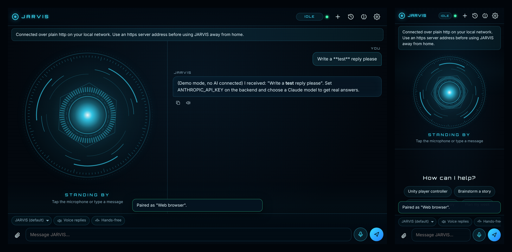

# JARVIS AI

A personal AI assistant for your **Android phone** and **Windows PC**, with a futuristic holographic interface, voice input and spoken replies, memory, safe PC control and Unity game-development help. It is powered by Claude through **your own small server**, so your AI key never sits inside an app.

> An original design inspired by film AI assistants. It uses no film graphics, logos or sounds, and is not affiliated with any studio.



## Downloads

| | File | Notes |
|---|---|---|
| Android | [`android/dist/jarvis-ai.apk`](android/dist/jarvis-ai.apk) | 836 KB, Android 8.0+. [How to install](docs/ANDROID.md#install-the-apk-on-your-phone) |
| Windows | [`windows/dist/JARVIS-AI-Setup-1.0.0.exe`](windows/dist/JARVIS-AI-Setup-1.0.0.exe) | 35 MB, Windows 10/11 64-bit, no admin rights needed. [How to install](docs/WINDOWS.md#install) |
| Server | [`backend/`](backend/) | Node.js. [Deploy it](docs/DEPLOY.md) to Fly.io, Render or any VPS |

Every push also rebuilds both apps on GitHub (**Actions** tab > latest **JARVIS AI** run > *Artifacts*), using the normal Gradle/Android Studio and .NET toolchains.

## Get started in four steps

1. **Get a Claude API key** at [platform.claude.com](https://platform.claude.com) and set a monthly spend limit there (Settings > Limits). See [costs](#what-it-costs).
2. **Deploy the server** ([docs/DEPLOY.md](docs/DEPLOY.md)). The easiest route is Fly.io: about 15 minutes, a few dollars a month, and you get an `https://your-name.fly.dev` address that works from anywhere. You choose a pairing password (`JARVIS_PASSWORD`) during setup.
3. **Install the apps**: the [APK](docs/ANDROID.md) on your phone, the [installer](docs/WINDOWS.md) on your PC.
4. **Connect**: open JARVIS, enter your server address and pairing password, and say hello.

No server yet? Tap **Try offline demo** on the connect screen. It lets you test the interface, the microphone and spoken replies with canned answers. It uses no AI.

## What it does

- **Chat with context** using Claude (Opus 5.5 by default; Sonnet 5.5 and Haiku 5.5 selectable in Settings). Replies stream in as they are written. **Stop** interrupts at any time.
- **Voice**: tap the microphone (or press **Ctrl+Alt+J** on Windows). Turn on **Voice replies** to hear answers spoken sentence by sentence while they arrive. Turn on **Hands-free** and JARVIS listens again after each spoken answer. You can change the voice, speed and volume (and pitch on Android). An optional wake word is available ([details](docs/VOICE.md)).
- **Conversation styles**: JARVIS, Concise, Teacher, Code expert, Unity game dev, Creative writer, Planner. You can also add your own custom instructions.
- **Web search** with real source links under the answer. JARVIS is told to separate confirmed facts from uncertain ones and to say when information may be out of date.
- **Memory**: JARVIS can remember facts, preferences, projects and standing instructions. You are shown every save (with **Undo**), and you can view, edit and delete memories in the Memory panel. Memory can be turned off.
- **History**: conversations are saved on your server. You can reopen, delete one, or clear all, or turn history off for temporary chats.
- **Attach files**: text and code files (for example a Unity script) go into your message.
- **Windows PC tools**, each one approved by you in a native dialog: open approved apps, folders and websites; search, list and read files in folders you approved; write files (with an automatic backup); create notes; run commands from *your* approved list; system info; notifications; a Unity project overview. There is an emergency stop (**Ctrl+Shift+F12**) and a full action log. [Details and safety rules](docs/WINDOWS.md#pc-tools-and-safety)
- **Unity help**: the Unity style writes complete C# scripts and explains how to hook them up in the Editor. On Windows it can read your project and, with your OK, edit scripts with backups. [Unity guide](docs/UNITY.md)
- **Privacy controls**: export all your data, delete everything, revoke a lost phone. [Where data lives](docs/PRIVACY.md)

## What it costs

| Item | Cost |
|---|---|
| Apps | Free |
| AI: Claude Opus 5.5 (default) | $4 per million input tokens, $20 per million output. A typical chat message is roughly 1-3 US cents. Long code answers cost more. |
| AI: Claude Sonnet 5.5 | $2 / $10 per million tokens, about half the cost of Opus |
| AI: Claude Haiku 5.5 | $0.10 / $0.50 per million tokens, a small fraction of a cent per message |
| Web search | About $10 per 1,000 searches (1 cent each), plus tokens. Can be turned off. |
| Server on Fly.io | Roughly $2-5/month for a small machine plus a 1 GB disk (needs a payment card) |
| Server on Render | $7/month (Starter) plus a disk, about $0.25/GB/month |
| Your own Linux VPS | Whatever you pay already; some providers have free tiers |

These are list prices when this was written. Check the provider's pricing page, because prices change. Repeated parts of a conversation are cached, which lowers the input cost. Opus thinks before answering, and that thinking is billed as output.

**Spending limits:**
- In the Anthropic Console, under Settings > Limits, set a monthly limit. This is the hard limit.
- JARVIS also has its own `DAILY_BUDGET_USD` (default $2 in `.env.example`). It refuses new requests once today's *estimated* cost reaches that amount.
- Settings > Connection shows today's and this month's estimates.

## How it fits together

```
 Android app (Kotlin)              Windows app (.NET 10)            Any browser
 ┌─────────────────────┐           ┌──────────────────────┐        ┌──────────────┐
 │ Shared web UI       │           │ Shared web UI        │        │ Shared web UI│
 │ (WebView)           │           │ (WebView2)           │        └──────┬───────┘
 │  ▲ bridge           │           │  ▲ bridge            │               │
 │ Native: speech in/  │           │ Native: Windows      │               │
 │ out, Keystore,      │           │ speech, wake word,   │               │
 │ permissions, files  │           │ PC tools + approval, │               │
 └─────────┬───────────┘           │ DPAPI, hotkeys, tray │               │
           │ HTTPS                 └──────────┬───────────┘               │
           └──────────────────┬───────────────┘───────────────────────────┘
                              ▼  HTTPS + device token
                ┌──────────────────────────────────┐
                │ JARVIS server (Node.js, Express) │  ← your Claude API key lives ONLY here
                │ chat streaming, tool loop,       │
                │ memory, history, settings, usage │──► Claude API (and web search)
                │ SQLite database                  │
                └──────────────────────────────────┘
```

The interface is written once ([`shared/ui`](shared/ui)) and runs inside both apps. Each app adds native features through one small JSON bridge. The server is the only thing that talks to the AI. Full details: [docs/ARCHITECTURE.md](docs/ARCHITECTURE.md).

## Project layout

| Path | What it is |
|---|---|
| [`backend/`](backend/) | The server: Express API, Claude integration (official Anthropic SDK), provider switching, SQLite storage, tests |
| [`shared/ui/`](shared/ui/) | The interface used by both apps and the browser: HTML/CSS/JS, no build step |
| [`android/`](android/) | Android Studio project (Kotlin, Gradle), `build-cli.sh`, `dist/jarvis-ai.apk` |
| [`windows/`](windows/) | .NET 10 solution: `JarvisAI.Desktop` (the app), `JarvisAI.Core` (tool logic), tests, installer script, `dist/` |
| [`tests/`](tests/) | End-to-end UI tests (headless Chromium against the real server) |
| [`deploy/`](deploy/), [`fly.toml`](fly.toml) | Docker Compose + Caddy (VPS), Render blueprint, Fly.io config |
| [`docs/`](docs/) | Guides: deploy, Android, Windows, voice, Unity, privacy, API, architecture, troubleshooting |
| [`.env.example`](.env.example) | Server configuration template (placeholders only) |

## Testing: what was verified, and how

| Part | Verified by | Result |
|---|---|---|
| Server API, pairing, chat streaming, tool loop, memory, history, privacy, budget, CORS | 38 automated tests (`npm test` in `backend/`) | All pass |
| Claude request format and stream parsing | The official SDK run against a local stand-in for the Claude API | Pass |
| Interface: pairing, chat, Markdown safety, memory, history, settings, voice and tool flows via a simulated native host, offline handling, phone layout | 15 tests in headless Chromium (`npm run test:ui`) | All pass |
| Android build | `build-cli.sh` here, plus Gradle `assembleDebug`/`assembleRelease` on GitHub Actions | Builds; APK signature verified |
| Android native code | JVM unit tests, plus Robolectric tests that boot `MainActivity` and drive the bridge (GitHub Actions) | All pass |
| Windows tool logic (folder rules, backups, command allowlist, timeouts, emergency kill) | 34 xUnit tests | All pass |
| Windows app | Compiles with no warnings; builds on GitHub's Windows runner; started under Wine up to the WebView2 check | Starts correctly |

**Not tested, be aware:**
- **Real AI calls.** No API key was available while building. Your first chat is the first live call. If something's wrong, the app shows the server's error message ([troubleshooting](docs/TROUBLESHOOTING.md)).
- **A real phone or emulator.** The APK has not been installed on a device. Android speech recognition and text-to-speech depend on your phone's speech services.
- **A real Windows PC.** The WebView2 interface, Windows speech, wake word, hotkeys and approval dialogs have not been run on actual Windows.
- **Unity.** Unity code that JARVIS writes is not compiled or tested in Unity. Check it in Play mode.

## Feature status

| Feature | Status |
|---|---|
| AI chat with context, streaming, stop/interrupt, styles, model choice | Implemented |
| Clear error messages (server unreachable, key rejected, rate limit, outage, budget reached, declined requests) | Implemented |
| Switch AI provider (Anthropic, any OpenAI-compatible API, offline mock) | Implemented; Anthropic is the main, best-supported path |
| Web search with sources | Implemented (Claude models) |
| Voice input / spoken replies / voice settings | Implemented (native on Android and Windows) |
| Wake word | Windows: offline, works while the app runs (including in the tray). Android: only while the app is open on screen. See [docs/VOICE.md](docs/VOICE.md) |
| Memory (view/edit/delete), history, custom instructions, privacy export/erase | Implemented |
| Windows PC tools with approvals, backups, action log, emergency stop | Implemented |
| Unity assistance (style + project overview/read/write on Windows) | Implemented; no Unity Editor plug-in |
| Splash screen, app icon, settings, permissions handling | Implemented |
| **Not implemented** | Always-on background wake word on Android; PostgreSQL storage (SQLite only); multiple user accounts; image/screenshot understanding; server-side speech recognition; automatic app updates; code-signed Windows installer (expect a SmartScreen warning); "Start with Windows"; iPhone app; Play Store listing |

## Building it yourself

- Server: `cd backend && npm install && npm test && npm start` ([details](docs/DEPLOY.md#run-it-on-your-pc-first))
- Android: open `android/` in Android Studio and choose Build > Build APK(s) ([details](docs/ANDROID.md#build-the-apk-yourself-on-windows))
- Windows: `windows\build.ps1` with the .NET 10 SDK and NSIS ([details](docs/WINDOWS.md#build-it-yourself))
- All tests: `npm install && npm test` in this folder (UI tests need `npx playwright install chromium` once)
