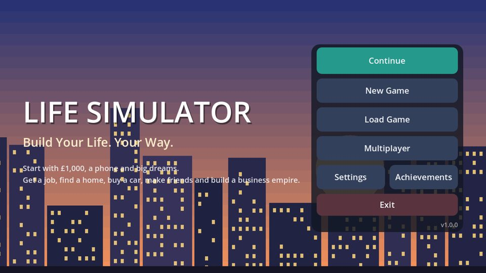
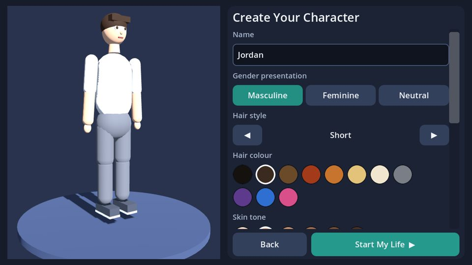
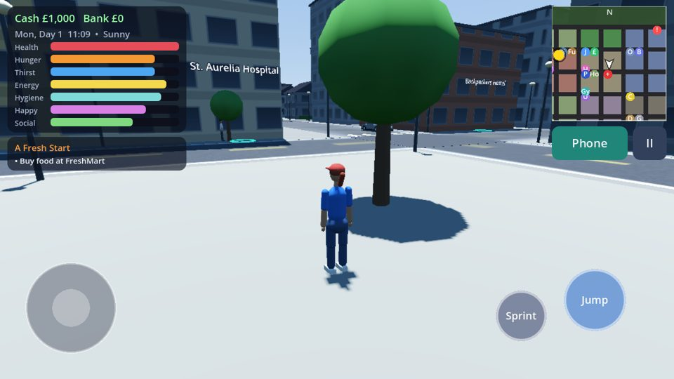
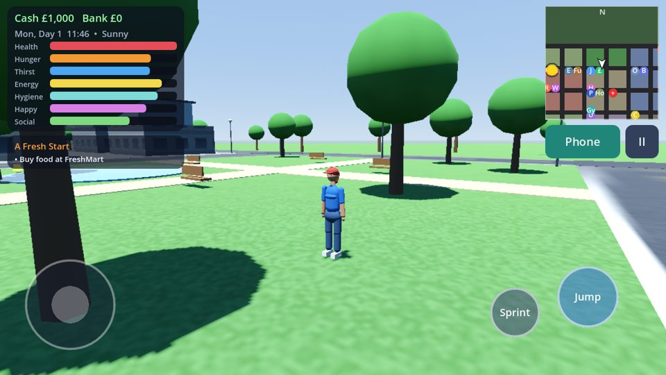
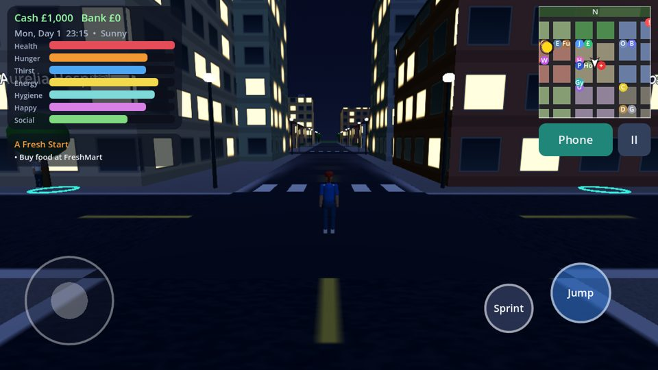
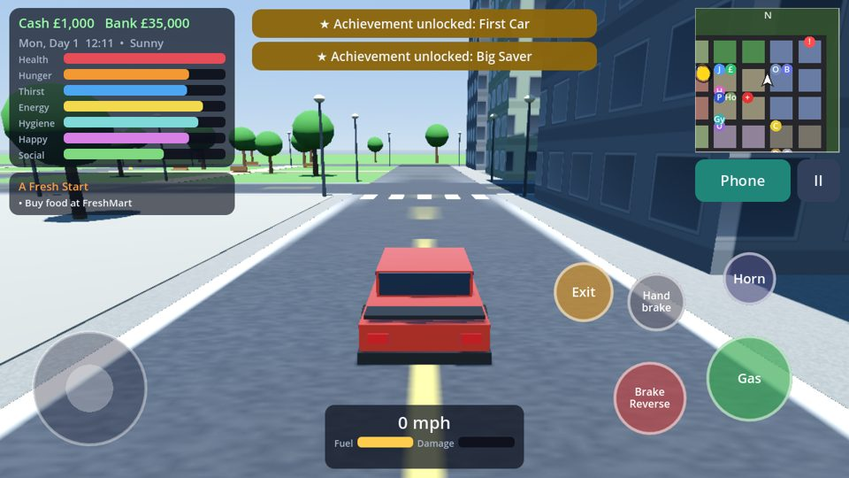
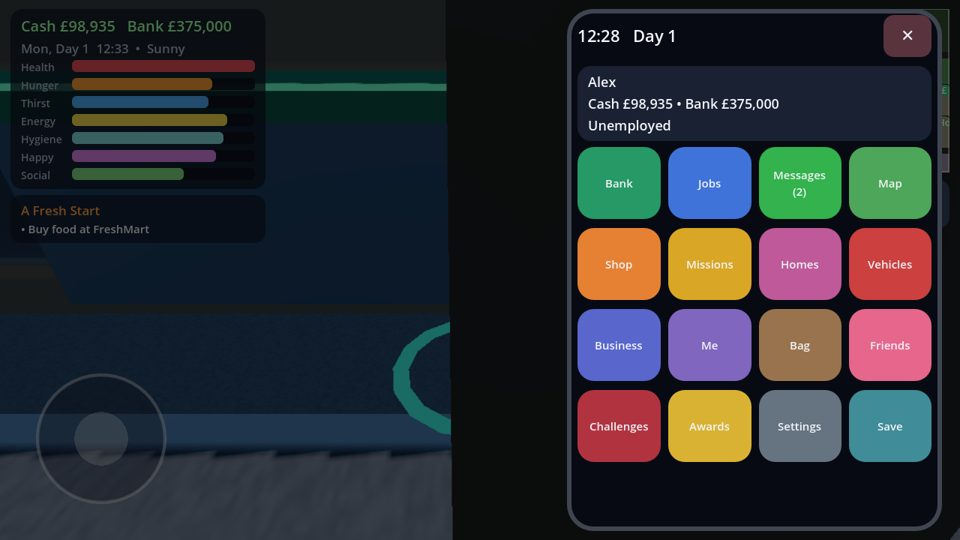
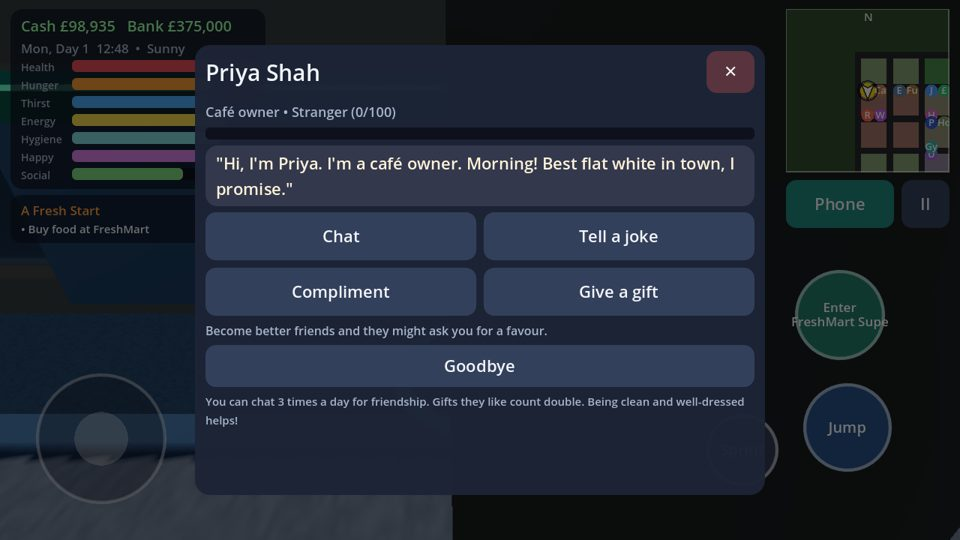

# Life Simulator

**Build Your Life. Your Way.**

A 3D open-world life simulation for Android, made with Godot 4.4 and GDScript. You arrive in the city with £1,000, basic clothes and an old phone. You have no home, no car and no job. What happens next is up to you.

**Download:** [`dist/life-simulator.apk`](dist/life-simulator.apk) (Android 7.0+ on 64-bit ARM, about 27 MB, version 1.0.0)

| | | |
| --- | --- | --- |
|  |  |  |
|  |  |  |
|  |  | |

## What you can do

| System | What's in it |
| --- | --- |
| **City** | A 300 m × 300 m city with seven districts: City Centre, Shopping, Business, Industrial, Residential, Midtown and Riverside Park. There are 40+ named places (supermarket, bank, hospital, police station, college, dealership, garage, fuel station, restaurants and homes), plus a day/night cycle, sun, cloud and rain, street lights and windows that light up at night, traffic that drives on the left, and 16 named residents with daily routines. |
| **Character** | A character creator with gender presentation, 7 hair styles, 11 hair colours, 6 skin tones, eye colour and a starter outfit (top, bottoms, shoes and accessory). Walk, run, jump, sit, sleep, drive and wave, all with procedural animation. |
| **Needs** | Hunger, thirst, energy, health, hygiene, happiness and social, each from 0 to 100. They change with time and with what you do. If you neglect them you slow down, people warm to you more slowly, you can collapse, and you can wake up in hospital. Nothing is permanent, so it never gets too punishing. |
| **Money** | Cash and a bank account in GBP, with deposits and withdrawals at ATMs, wages paid into the bank, weekly rent and bills, and income, expense and transaction history. Every transaction is checked before it goes through. |
| **Jobs** | Nine careers: Delivery Driver, Shop Assistant, Cleaner, Mechanic, Security Guard, Police Officer, Office Worker, Doctor and Business Manager. Each has its own hours, pay, requirements (qualifications from City College, a smart outfit, previous experience) and four career levels with promotions. You go to work during your shift and do the job yourself: delivery and patrol routes across the city, or tap, memory and decision mini-games. |
| **Property** | Studios, small houses, a family house, a luxury house and a mansion. You can rent, buy, sell, upgrade, redecorate and furnish them. Enter your home to sleep, shower, eat, watch TV and more. |
| **Vehicles** | Scooters, hatchbacks, saloons, an SUV, a van, a sports bike, a sports car and a supercar. Arcade driving physics, collision damage, fuel, respraying, three engine stages, repairs, fuel cans and repair kits, and delivery to wherever you are. Vehicles stay where you park them. |
| **Inventory** | 60+ items across food, drinks, clothing, electronics, furniture, tools, vehicle parts and collectibles. Items stack, take up slots (a backpack adds more), have icons and descriptions, and can be bought, sold, used, equipped or thrown away. Ten hidden collectibles are scattered around the city. |
| **Missions** | An 11-part main story, plus side, daily (three new ones every day), career, driving time trial, business, exploration and favour missions for friends. Each has objectives, rewards, a tracker and a minimap waypoint. |
| **Boss challenges** | Business Tycoon (beat Apex Holdings' profits), Street Racing Champion (race three AI rivals), Property Mogul and Career Challenge. Each comes in Easy, Normal and Hard, with prizes to match. |
| **Business** | Restaurant, clothing shop, car dealership, supermarket, repair garage and tech shop. Hire staff, buy stock, set prices, upgrade the premises and collect profits. Every day the game simulates customers, sales, wages and reputation. |
| **Friends** | Chat, joke, compliment and give gifts (each person likes certain kinds of gift). Friendship has five levels, friends ask you for favours, and you can date. |
| **Achievements** | 24 achievements with unlock notifications. They're stored permanently and shared across all save slots. |
| **Saving** | Three slots, autosave (every few minutes, every new day, and when the app goes to the background), manual saves, Continue and New Game. Saves are checksummed and written atomically with a backup copy, so a damaged or edited save falls back to its backup instead of crashing. |
| **Multiplayer** | Host or join over ENet (Wi-Fi or the internet), or run a headless dedicated server. Players see each other move, see each other's names, and can chat. The server is authoritative: clients can never change their own money or inventory. See [docs/MULTIPLAYER.md](docs/MULTIPLAYER.md). |
| **Audio** | Original music (menu, city day, city night, race) and sound effects (footsteps, engine, horn, crashes, cash register, doors, notifications, rain), all synthesised by `tools/make_audio.py`. There are separate master, music and effects volumes. |
| **Phone** | A smartphone in the game with 16 apps: Bank, Jobs, Messages, Map, Shop (delivery), Missions, Homes, Vehicles, Business, Me, Bag, Friends, Challenges, Awards, Settings and Save. |
| **Android** | Landscape, multi-touch controls, back button support, Low/Medium/High graphics presets, a 30 FPS cap on Low and Medium to save battery, and the Compatibility (GLES3) renderer for the widest device support. |

All art is original and built from Godot primitives in code (characters, vehicles, buildings and props). There are no third-party assets.

## Controls

| Action | Touch | Keyboard / mouse |
| --- | --- | --- |
| Move | Left side of the screen: floating joystick | W A S D / arrows |
| Look around | Drag on the right side of the screen | Drag with the mouse, wheel to zoom |
| Jump / Sprint | Buttons, bottom right | Space / Shift |
| Interact | **Use** button (shows what it does) | E |
| Get in or out of a vehicle | **Drive** / **Exit** button | F |
| Drive | Gas, Brake/Reverse, Handbrake and Horn buttons, steer with the joystick | W/S, A/D, Ctrl (handbrake) |
| Phone | **Phone** button | Tab |
| Pause / back | Android back button, **II** | Esc |
| Chat (online) | Chat box | T |

## Running it

1. Install [Godot 4.4.1](https://godotengine.org/download/archive/4.4.1-stable/) (the standard build, not .NET).
2. Open `project.godot` from this folder and press **Play**.

To build the APK, see [docs/ANDROID_EXPORT.md](docs/ANDROID_EXPORT.md). In short, install the export templates, point Godot at an Android SDK, then run `tools/build_apk.sh`.

## Tests

```sh
godot --headless --path . -s tools/check_scripts.gd                  # compile every script
godot --headless --path . res://scenes/tests/test_runner.tscn         # 332 unit and scene tests
godot --headless --path . res://scenes/tests/soak_test.tscn           # a full game day at 10x speed
tools/run_net_test.sh                                                 # multiplayer: dedicated server + host mode
xvfb-run -s "-screen 0 1280x720x24" godot --path . --rendering-driver opengl3 \
    res://scenes/tests/screenshot_tour.tscn -- --out /tmp/shots       # rendered screenshots
```

The test runner covers every rule system (economy, inventory, needs, jobs, property, vehicles, business, missions, challenges, relationships), save validation and corruption recovery, and a scripted play-through of the real game world. That play-through opens every menu and phone app, walks, drives, enters a home, works a shift, rolls over to a new day, starts a race and saves. The network test starts a headless dedicated server and two clients, and checks that a cheating client can't forge money or items, then does the same for "Host Game" mode. See [docs/TESTING.md](docs/TESTING.md).

## Project layout

```
autoload/      GameManager, SaveManager, EconomyManager, AudioManager, MissionManager,
               MultiplayerManager, AchievementManager, DataDB, Settings, WorldClock
scripts/core/  PlayerState (the save/network data), ActionRouter (every validated action),
               NeedsRules, Money
scripts/economy|inventory|jobs|property|vehicles|business|missions|npc/
               the rule modules (pure functions on the player state, shared by the
               single-player game and the multiplayer server)
scripts/city/  CityLayout (map data), city builder, environment (day/night/weather), world
scripts/player/ player controller, camera, character model
scripts/vehicles/ vehicle physics, vehicle model, races and time trials
scripts/npc/   residents and traffic
scripts/ui/    HUD, touch controls, minimap, phone, every menu panel
scripts/multiplayer/ remote players, dedicated server, multiplayer menu
scripts/tests/ automated tests
scenes/        main, menus, player, vehicles, npc, city, buildings, multiplayer, tests
resources/     game data as JSON: items, jobs, vehicles, properties, businesses,
               NPCs, missions, challenges, achievements
assets/        generated audio, icons, the facade shader
tools/         audio/icon generators, script checker, APK build, network test
docs/          multiplayer, Android export, testing, development phases
```

The design is modular. To add an item, job, vehicle, property, business, mission or achievement, add an entry to the JSON in `resources/`. To add a district, building or location, edit the tables in `scripts/city/city_layout.gd`. The map, NPC navigation and minimap pick it up automatically.

## Honest limitations

- The APK has been built, signed and checked, and the exported game runs on desktop (including as the dedicated server). It hasn't been tested on a physical Android phone or an emulator yet, because none was available where it was built.
- The graphics are stylised low-poly primitives with procedural animation, not rigged character models.
- Multiplayer has been tested over localhost (a dedicated server with two clients, and host mode). Internet play needs UDP port forwarding or a hosted server. Residents and traffic are simulated on each device rather than synced, and mission progress is tracked on each device. Only the rewards go through the server, and each can be claimed once.
- Furniture goes into automatic slots around the room rather than being freely placed.

## Credits

Code, art, music and sound are all original work for this project, made with [Godot Engine](https://godotengine.org) (MIT licence).
